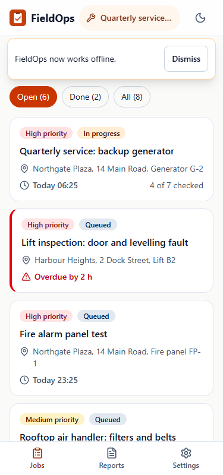
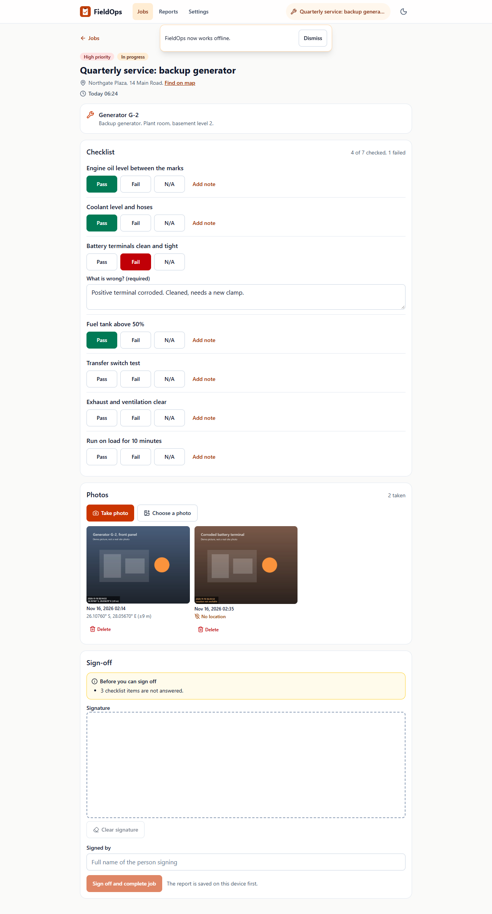
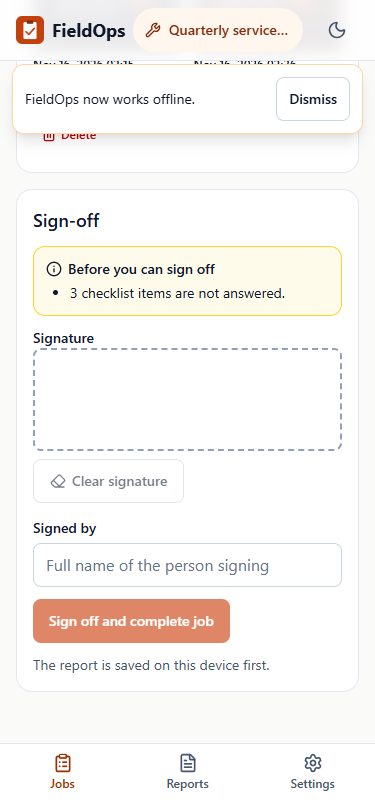
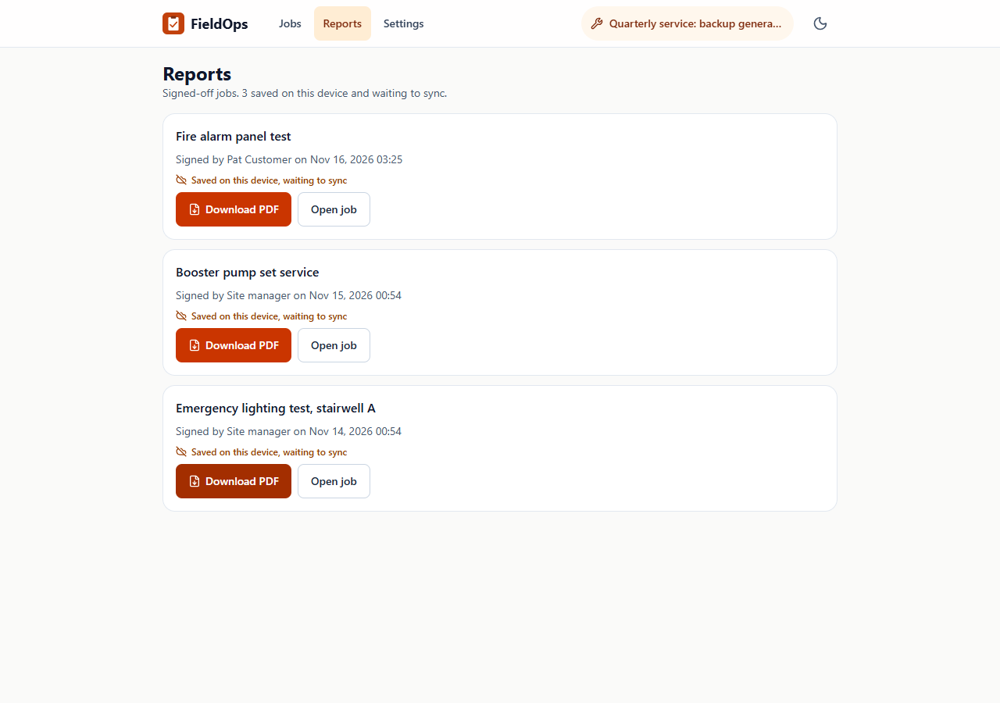

# FieldOps

A mobile-first tool for field technicians. Work a dispatch queue by priority, run inspection checklists on each asset, take photos stamped with the time and GPS position, collect a customer signature and export a PDF summary. It installs as an app and works with no connection.

**Live demo:** https://fieldops-384.netlify.app



## What to demo to a recruiter
- Open the app: eight dispatched jobs are already there (one under way, one overdue, two signed off). No sign-up. The queue is sorted the way a technician works: the job in hand first, then by priority and due time.
- Open the job under way, finish its checklist and try to sign off early: the app explains exactly what is missing (an unanswered item, a failed item with no note, a failure with no photo). Take a photo (the time and GPS position are burned into the picture, and if location is blocked the photo is still saved and flagged), sign with a finger and download the PDF.
- Switch the browser to offline and reload. Start a job, answer, photograph, sign and export again. Everything is saved on the device first and marked "waiting to sync".

## Expo or PWA? (decision for step 1)
The brief allows React Native with Expo or a React + Vite PWA. **This is a PWA.** A PWA deploys to Netlify as a plain static site, installs from the browser, works offline, and the camera, location and signature features all exist in the browser (getUserMedia, Geolocation, pointer events). A native Expo build was not done, so there is no app-store build and no background sync.

## Features
- **Dispatch queue:** sorted by status, priority and due time, overdue jobs flagged in words as well as colour, filters for open and done.
- **Job detail:** site (with a map link), asset, start job, and a locked-until-started checklist.
- **Inspection checklist:** pass, fail or N/A per item with notes (saved as you type), choosing the same answer again undoes it, a failed item must be explained.
- **Photos with proof of place and time:** rear camera inside the app (or a file picker fallback), the time and coordinates burned into the JPEG, kept even when location is denied or times out, and flagged "No location".
- **Signature and sign-off:** finger, pen or mouse signature pad, name of the signer, one transaction that stores the report and marks the job done. After sign-off the job is locked.
- **PDF summary:** one tap, built on the device with jsPDF (loaded only when needed): job, asset, checklist with failures highlighted, photos with their stamps, signature.
- **Reports list:** every signed-off job with its sync status and a PDF re-download.
- **Installable and offline:** manifest, precached shell, update banner that lets the user choose when to reload. Dark and light theme, mobile-first at 375 px.

### Phase 2
- Sync of reports to Neon through a Netlify Function (reports already carry a `synced` flag, currently always false)
- Asset QR lookup
- Offline map of job sites (Leaflet)
- Manager view of submitted reports

## Stack
React 19, Vite, TypeScript (strict), Tailwind CSS 4, Dexie (IndexedDB), jsPDF, lucide-react, vite-plugin-pwa, Vitest, oxlint.

## Architecture notes
- **Local first.** All data is in IndexedDB (`src/db/schema.ts`): assets, jobs, checklist items, photos (as image blobs), reports and settings. No network call is needed for any flow.
- **One data layer.** `src/db/repo.ts` is the only code that writes. It validates everything and enforces the workflow: items can only change while a job is in progress, photos are capped (20 per job, 4 MB each), and `completeJob` re-checks the blockers, writes the report and flips the job to done in a single transaction, so a job is never "done" without a report.
- **Rules as pure functions.** `src/lib/jobs.ts` (sorting, overdue, checklist progress, `completionBlockers`), `stamp.ts` (stamp text, resizing, burning the label in), `signature.ts` (is this ink a real signature?), `geo.ts` (position lookup that never rejects and says why it failed) and `pdf.ts` are tested without a browser.
- **Signature pad.** Strokes are stored in a fixed 600 by 200 space, so the signature looks the same after a rotation. The newest strokes are kept in a ref because pointer moves can arrive faster than React re-renders.
- **Safe demo seed.** The demo (including generated pictures and a signature) is built after the page has loaded and gone idle, and inserted by `seedIfEmpty`, which counts and writes in one transaction, so it can never overwrite work the technician started in the meantime.
- **PDF text.** The built-in PDF fonts only cover Latin-1, so anything else is replaced with `?` rather than printing garbage.
- Hash routing (`#/jobs`, `#/job/:id`, `#/reports`, `#/settings`) so a static host needs no rewrite rules.

## Run locally
```bash
npm install
npm run dev          # http://localhost:5317
```
Checks: `npm run typecheck`, `npm run lint`, `npm test` (60 tests), `npm run build`. Try the installable build with `npm run build && npm run preview` (http://localhost:4187). No environment variables are needed. The camera and location need a secure page: `localhost` and https both work.

## What was verified, and what was not
- Verified: typecheck, lint, 60 unit tests, production build, and 86 real-browser checks (Chromium via Playwright) at 375 px and 1280 px: queue order and filters, checklist rules and persistence, a real camera stream (Chromium's fake camera device) producing a stamped JPEG, simulated GPS (coordinates and accuracy stored), location refused, camera refused, picking a file instead, signature validation, sign-off, PDF contents (real PDFs parsed for text and images), reports list, delete and reload of demo data, and the whole flow offline. No console errors. Lighthouse on the preview build: Performance 98, Accessibility 100, Best Practices 100, SEO 100.
- Not verified: a real phone camera and GPS, iPhone Safari, signing with a real finger on a touch screen, large photo volumes, a deployed Netlify build. The picture "stamp" is burned in the browser and is not tamper-proof evidence.
- Syncing to a server is not built. Everything stays on the device, so clearing browser data removes it. The demo jobs, pictures and signatures are synthetic.

## Screenshots
| Job | Sign-off | Reports |
| --- | --- | --- |
|  |  |  |

## Status
Built and tested locally. Deploy pending.